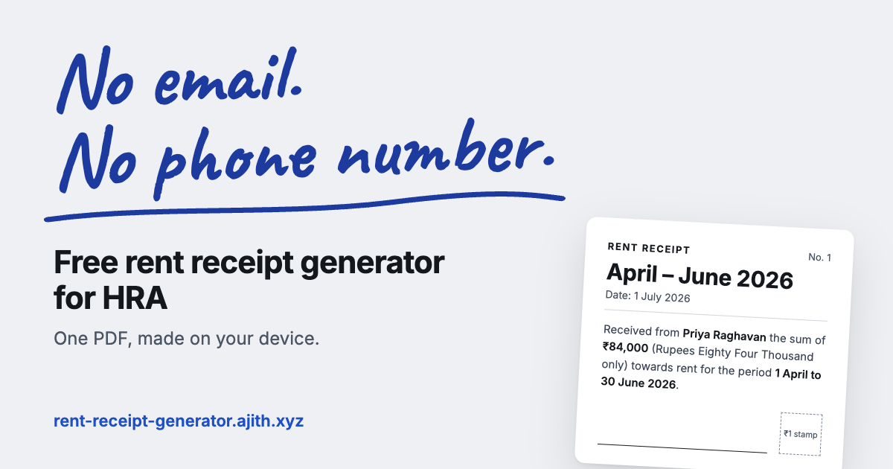

# Rent receipt generator

**No email. No phone number.** Free rent receipts for HRA, made entirely in your browser.

**[rent-receipt-generator.ajith.xyz](https://rent-receipt-generator.ajith.xyz)**

[](https://rent-receipt-generator.ajith.xyz)

Fill in the blanks on the receipt itself and get one PDF with a receipt for every month or quarter, ready to print and hand to your employer.

## What it does

- **The receipt is the form.** You type into the receipt as it will print; the preview after you generate is exactly what the PDF says.
- **Moved or your rent changed?** Add another stay for each home, owner or rent. Every receipt lands in one PDF, in strict date order.
- **Monthly or quarterly**, quarters following the financial year.
- **Indian number format and the amount in words**: ₹28,000 (Rupees Twenty Eight Thousand only).
- **Exact periods and dates**: 1 April 2026 to 30 April 2026, dated 1 May 2026; March receipts are dated 31 March so they stay in the financial year.
- **Knows the rules**: tells you when the owner's PAN is needed (rent over ₹1 lakh in a financial year) and when a ₹1 revenue stamp applies (receipts over ₹5,000), and adds a signature line and stamp box only if you want them.
- **A clean PDF**: A4, two receipts per page with a cut line, no ads, logos, links or credits on the receipts.

## Nothing you type leaves your browser

There is no server and no account. The page is static files, and the PDF is drawn on your device by a small PDF writer in this repo, with no third-party code involved (`src/pdf/writer.ts`).

The code never sends anything, and the browser backs that up. The site sends a Content-Security-Policy that blocks fetch, XHR, WebSockets and beacons (`connect-src 'none'`), forbids form submissions, and lets scripts, styles, fonts and images come only from the site itself. So the page has no way to upload your name, address or your owner's PAN. (A policy like this can't close every channel; leaving the page or WebRTC fall outside it. That's why the code is small and open for you to read.)

You can check it yourself:

```sh
curl -sI https://rent-receipt-generator.ajith.xyz | grep -i content-security-policy
```

Or open your browser's developer tools on the Network tab while you fill in the form: after the page and its code load, nothing else is requested. No analytics, no cookies, no third-party anything.

## Not tax advice

The guidance in the tool comes from the Indian Stamp Act, 1899 (Schedule I, Article 53) and from income-tax guidance on HRA and Form 124 (Form 12BB before April 2026). Rules and employer practice change; check with your employer or a tax adviser. Use it only for rent you have actually paid.

## Develop

Node 22.18 or later. Vite, TypeScript and Preact; Vitest and Playwright for tests.

Before changing anything, read [AGENTS.md](AGENTS.md): the privacy rules the code must keep, where else to update when you change something, and how to test. Coding agents read it automatically. More in [docs/](docs/): [architecture](docs/architecture.md), [gotchas](docs/gotchas.md), [decisions](docs/decisions.md), [receipt rules](docs/rules.md) and [testing](docs/testing.md).

| Command | Does |
|---|---|
| `npm install` | Install dependencies |
| `npm run dev` | Dev server |
| `npm run build` | Type-check, run the unit tests, and build static files into `dist/` (so a failing test stops a deploy) |
| `npm run preview` | Serve the build (with the CSP) |
| `npm test` | Unit tests (Vitest): amount in words, dates, ordering, quarters, PAN totals, PDF layout, fonts, CSP |
| `npm run test:e2e` | Browser tests (Playwright): Chrome, Firefox, WebKit, phone sizes, axe accessibility scans |
| `BASE_URL=https://rent-receipt-generator.ajith.xyz npm run test:e2e` | The same browser tests against the live site |
| `npm run fonts` | Re-subset Inter and Caveat after changing `src/lib/charset.ts` or the headline |
| `npm run og` | Render the link-preview image `public/og.png` from `og/og.html` |
| `npm run deploy` | Build and deploy to Cloudflare by hand (pushes to `main` deploy automatically) |

## Layout

| Path | What |
|---|---|
| `index.html` | Static page: headline, intro, the Why use this? / How it works / Sample receipt dialogs, footer, structured data |
| `src/app/` | The form (Preact), mounted into `#tool` |
| `src/lib/` | Months and dates, money and words, receipts and checks, receipt wording, printable characters |
| `src/pdf/` | PDF layout behind a small canvas interface, drawn by our own PDF writer; loaded only once you start typing |
| `fonts/source/` | Inter 4.1 and Caveat (SIL OFL); `src/assets/fonts/web/` (page) and `src/assets/fonts/pdf/` (PDF) are generated subsets; the licences are published from `public/fonts/` |
| `public/_headers` | Security headers for Cloudflare static assets |
| `AGENTS.md` | How to work on the code: privacy rules, commands, change recipes (`CLAUDE.md` imports it) |
| `docs/` | Architecture, gotchas, design decisions, the receipt and tax rules, and testing |
| `spike/` | The first PDF library comparison (LibPDF, jsPDF, pdf-lib); superseded by the benchmark in `docs/decisions.md` |
| `test/` | Unit tests; `test/e2e/` browser and accessibility tests |
| `wrangler.jsonc` | Cloudflare static-assets Worker on `rent-receipt-generator.ajith.xyz` |

## Licences

Code: [MIT](LICENSE). Fonts: Inter and Caveat, SIL Open Font License 1.1 (`fonts/source/OFL-inter.txt`, `fonts/source/OFL-caveat.txt`).

Made by [Ajith](https://ajith.xyz).
